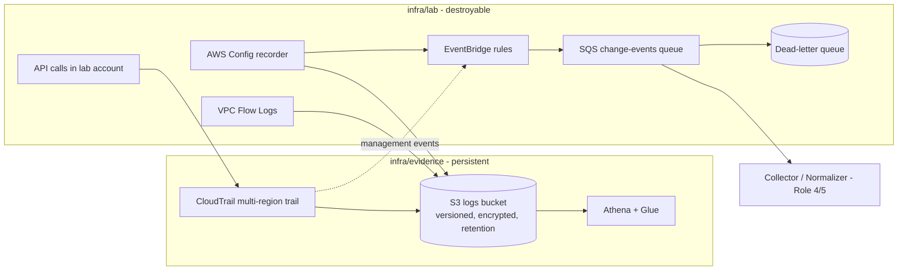

# Log architecture

Single lab account in the Region AWS assigned to the project (eu-north-1 here). A single-Region CloudTrail trail is used because the new AWS experience does not support multi-Region features. The log bucket, CloudTrail and Athena live in a separate Terraform stack so that
destroying the lab never deletes report evidence. Config records 7 resource types only (cost control).
Failed queue processing goes to a DLQ after 5 attempts.
